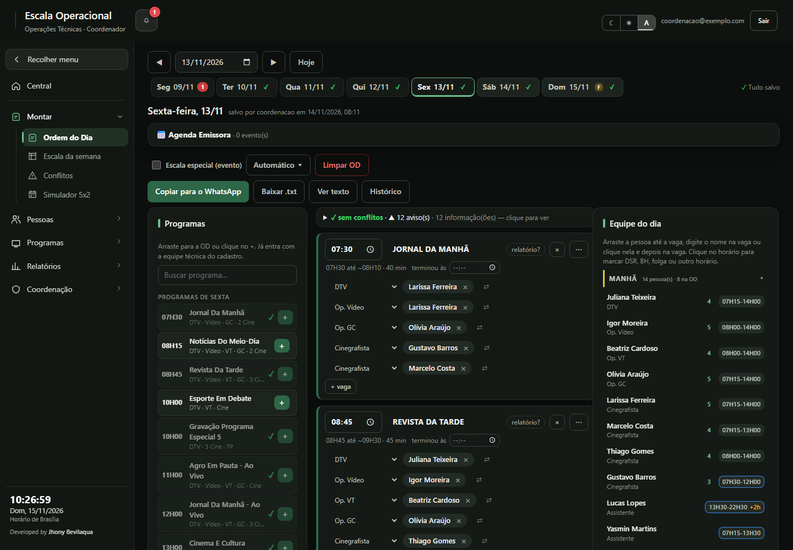
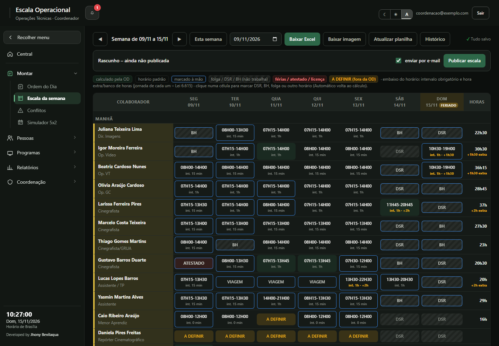
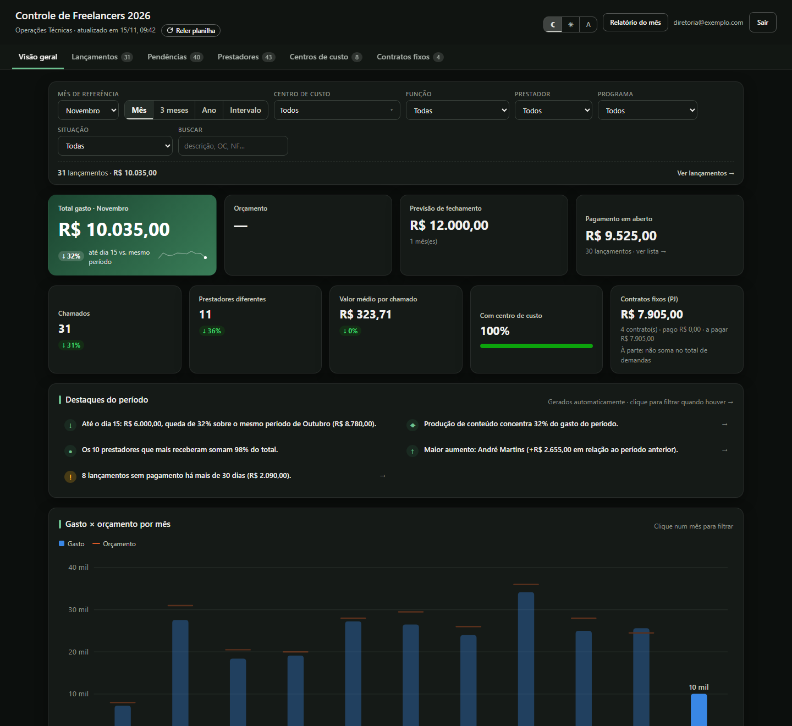
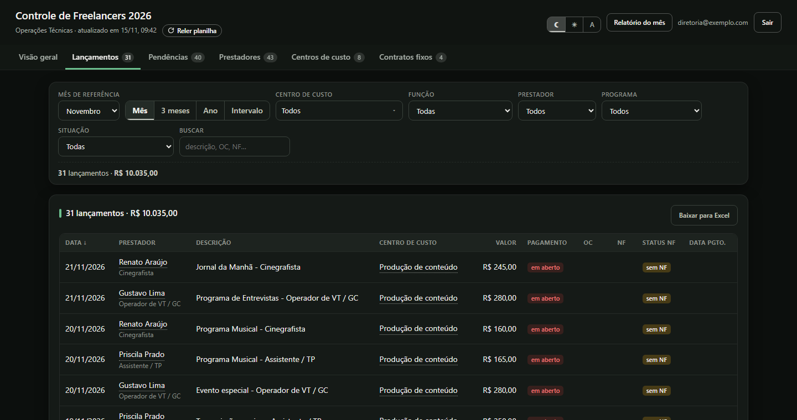
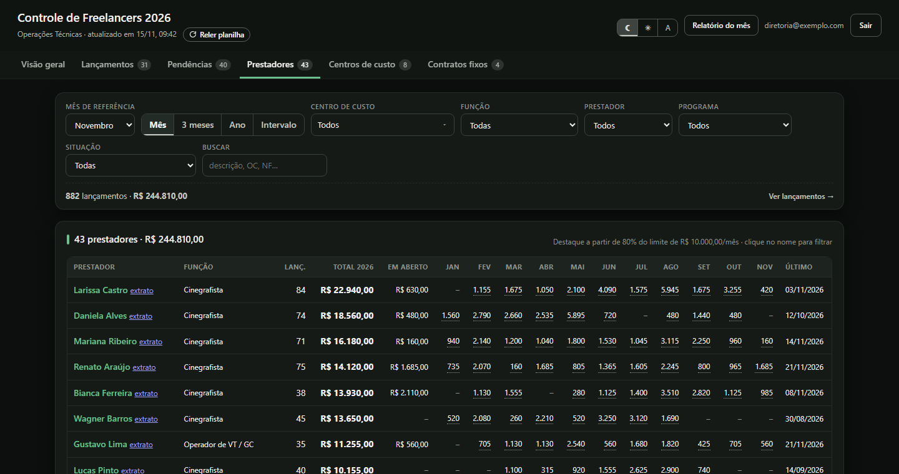
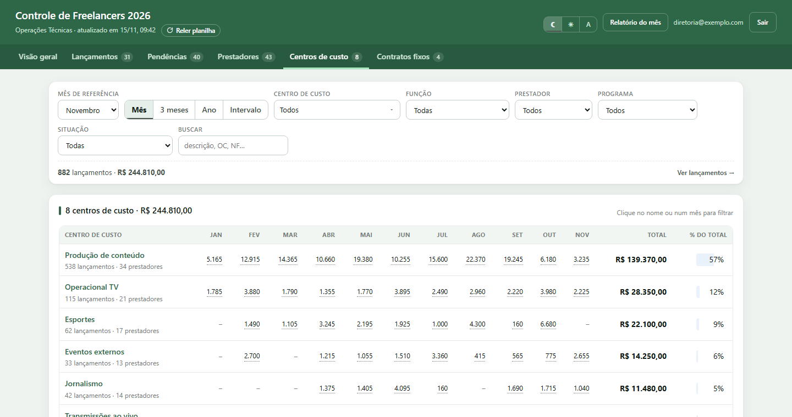
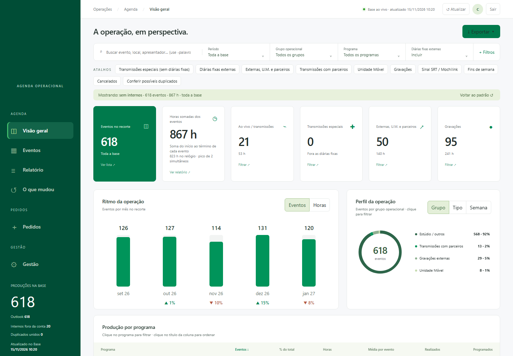
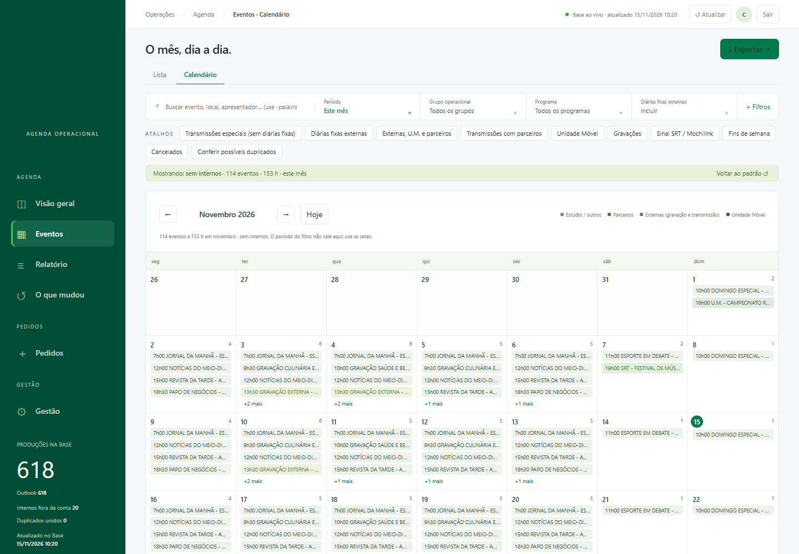
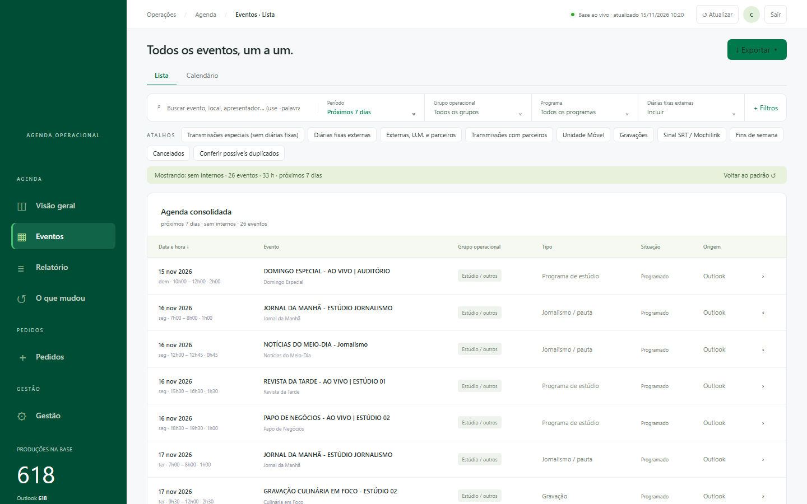

<h1>Jhony Bevilaqua</h1>

**Coordenador de Operações Técnicas · Broadcast & Transmissão ao Vivo · Automação de processos para TV**

📍 Curitiba, PR · [LinkedIn](https://www.linkedin.com/in/jhonybevilaqua)

---

### Sobre mim

Trabalho com televisão desde 2011: comecei no controle mestre, passei pela direção de imagens e hoje coordeno as
operações técnicas da **TV Evangelizar**, emissora com cobertura nacional. Meu dia a dia é fazer a programação ir ao ar
com qualidade: escala de equipes, ordem do dia, transmissões ao vivo, rede de retransmissoras, orçamento e fornecedores.

Nos últimos tempos passei a transformar os problemas da operação em **sistemas web**, construídos com apoio de
inteligência artificial (Claude Code). Assim, planilhas e controles manuais viram painéis e automações que a equipe e a
diretoria usam todos os dias.

### Sistemas que desenvolvi para a operação

| Sistema | O que resolve |
|---|---|
| **Central de Operações** | Escala da equipe técnica, ordem do dia, ponto e banco de horas num lugar só |
| **Painel de Freelancers** | Controle de prestadores, pagamentos, pendências e centros de custo, lido direto da planilha oficial |
| **Agenda Operacional** | Agenda de gravações e transmissões com filtros, relatórios e alertas de mudança |
| **Painel da Rede de Retransmissoras** | Situação das retransmissoras da emissora pelo país |
| **Aprovação de Conteúdo** | Direção aprova, reprova e comenta o conteúdo dos programas, integrado ao sistema de jornalismo |
| **Chat ao Vivo** | Chat da transmissão no YouTube exibido no ar, no padrão visual da TV |
| **Apuração Eleitoral** | Dados oficiais do TSE convertidos automaticamente para o gerador de caracteres e para gráficos no ar |
| **Orçamento Anual da Área Técnica** | Planejamento de custos da operação com premissas e simulações |
| **Almoxarifado Técnico** | Inventário de equipamentos, saídas, devoluções, inspeções e vida útil |

> Os repositórios são privados, por conterem dados internos da emissora.

### Em imagens

*Todas as imagens usam dados fictícios: nomes, valores e programas inventados, sem marca da emissora.*

#### Central de Operações: Ordem do Dia e escala da equipe

Monta a ordem do dia arrastando programas e pessoas; a escala da semana sai dela, com as regras de jornada (Lei 6.615/CLT),
intervalos, banco de horas, folgas e alertas de conflito.

#### Painel de Freelancers

Lê a planilha oficial de controle e mostra gastos, pendências de pagamento e nota fiscal, prestadores e centros de custo.

<table>
<tr>
<td width="50%"> Lançamentos com filtros e exportação para Excel</td>
<td width="50%"> Prestadores mês a mês</td>
</tr>
<tr>
<td colspan="2"> Centros de custo (tema claro)</td>
</tr>
</table>

#### Agenda Operacional

Junta as fontes de agendamento da emissora numa agenda só, com indicadores, calendário, filtros, relatórios e alertas de mudança.

<table>
<tr>
<td width="50%"> Calendário do mês</td>
<td width="50%"> Lista de eventos</td>
</tr>
</table>

### Experiência

- **TV Evangelizar:** Coordenador de Operações Técnicas (atual), antes Supervisor
- **Diretor de Imagens (freelancer):** transmissões e eventos ao vivo
- **Tarobá:** Gerente de Operações Internas (2015–2019), Diretor de Imagens (2012–2014), Operador de Master (2011–2012)

### Áreas de atuação

`Operações de broadcast` · `Produção e transmissão ao vivo` · `Direção de câmeras e corte` · `Coordenação de equipes` ·
`Controle mestre` · `Streaming (RTMP/SRT)` · `Gerador de caracteres` · `Automação de processos`

### Ferramentas que uso nos sistemas

